# Fsaverage reconstruction and diagnostic distance report

All 5,124 planned jobs have finished: 5,118 PASS and 6 FAIL. Sub-03 has 588 successful jobs. PASS means numerical solver completion; it does not establish anatomical accuracy.

The measured quantity is unregistered Euclidean HEAD-coordinate separation in millimetres. The stimulation midpoint was converted from each test subject’s native surface coordinates to native HEAD using its own H5 transform. No MRI registration or intersubject anatomical mapping was applied. localization_error_valid remains false throughout.

Sub-03 uses a candidate sensor-to-template alignment that failed QA and remains exploratory. The other six subjects retain anatomical review requirements. The report includes all seven and also supplies separate six-subject and sub-03 analyses.

## Experiment and analysis policy

Twelve methods use fsaverage anatomy with test-specific forward models and frozen LOSO or single-reference parameter selections. Reference identities also control nominal channel selection and bad-channel replacement. Cortical methods retain the original known-stimulation-hemisphere peak policy; Continuous-ECD and RAP-MUSIC retain maximum-GOF selection. No whole-brain peak sensitivity results were generated for this fsaverage run.

Historical baseline values are the original all-pass, in-sample-selected within-subject errors, included once per test run. Their metric differs from the cross-anatomy diagnostic distances. They provide context rather than an unbiased held-out performance benchmark. Baseline plots do not represent a new fsaverage within-subject fit.

Boxplot samples are successful run-level results. Single-reference results repeat each test run under six reference identities; those observations are not independent participants. Failure rates retain all planned jobs in the denominator. Equal-subject summaries first calculate each test subject’s median across its available run/reference results, then average those medians. No statistical significance tests are claimed.

## Completion and failures

| strategy | status | count |
| --- | --- | --- |
| LOSO | PASS | 732 |
| Single-reference | FAIL | 6 |
| Single-reference | PASS | 4386 |

| strategy | method | test_subject | reference_subject | run | failure_reason |
| --- | --- | --- | --- | --- | --- |
| Single-reference | Gamma-MAP | sub-04 | sub-02 | run-05 | Exception: No active dipoles found. alpha is too big. |
| Single-reference | Gamma-MAP | sub-05 | sub-02 | run-06 | Exception: No active dipoles found. alpha is too big. |
| Single-reference | Gamma-MAP | sub-05 | sub-02 | run-08 | Exception: No active dipoles found. alpha is too big. |
| Single-reference | Gamma-MAP | sub-06 | sub-02 | run-05 | Exception: No active dipoles found. alpha is too big. |
| Single-reference | Gamma-MAP | sub-05 | sub-07 | run-08 | Exception: No active dipoles found. alpha is too big. |
| Single-reference | Gamma-MAP | sub-06 | sub-07 | run-05 | Exception: No active dipoles found. alpha is too big. |

All six failures were inherited Gamma-MAP cases with no active dipoles at the frozen alpha. Their missing distances were not imputed, and none occurred in sub-03.

## All seven subjects (includes exploratory sub-03)

7 test subject(s), 5124 jobs, 5118 PASS. Historical baseline: 732 distinct method/test-run values. Values below are pooled successful diagnostic distances; see equal-subject CSV for participant weighting.

| strategy | method | n_total | n_pass | median_mm | q25_mm | q75_mm |
| --- | --- | --- | --- | --- | --- | --- |
| LOSO | Champagne | 61 | 61 | 26.98 | 15.82 | 41.84 |
| LOSO | Continuous-ECD | 61 | 61 | 22.36 | 14.57 | 29.97 |
| LOSO | Gamma-MAP | 61 | 61 | 29.43 | 15.82 | 42.12 |
| LOSO | LCMV | 61 | 61 | 24.94 | 16.84 | 34.92 |
| LOSO | MNE | 61 | 61 | 29.74 | 20.05 | 43.31 |
| LOSO | MxNE | 61 | 61 | 25.73 | 15.56 | 36.39 |
| LOSO | RAP-MUSIC | 61 | 61 | 22.99 | 14.87 | 30.37 |
| LOSO | SESAME | 61 | 61 | 18.62 | 13.35 | 27.60 |
| LOSO | dSPM | 61 | 61 | 18.93 | 14.29 | 30.16 |
| LOSO | eLORETA | 61 | 61 | 27.80 | 15.82 | 38.75 |
| LOSO | irMxNE | 61 | 61 | 26.46 | 18.56 | 41.32 |
| LOSO | sLORETA | 61 | 61 | 30.20 | 18.96 | 41.26 |
| Single-reference | Champagne | 366 | 366 | 29.86 | 18.94 | 44.04 |
| Single-reference | Continuous-ECD | 366 | 366 | 25.14 | 17.37 | 32.61 |
| Single-reference | Gamma-MAP | 366 | 360 | 28.94 | 18.62 | 41.34 |
| Single-reference | LCMV | 366 | 366 | 27.30 | 18.54 | 39.49 |
| Single-reference | MNE | 366 | 366 | 31.72 | 21.75 | 43.88 |
| Single-reference | MxNE | 366 | 366 | 26.98 | 17.42 | 38.18 |
| Single-reference | RAP-MUSIC | 366 | 366 | 23.95 | 15.98 | 32.54 |
| Single-reference | SESAME | 366 | 366 | 17.89 | 13.43 | 26.82 |
| Single-reference | dSPM | 366 | 366 | 23.63 | 16.48 | 33.65 |
| Single-reference | eLORETA | 366 | 366 | 28.23 | 18.28 | 39.88 |
| Single-reference | irMxNE | 366 | 366 | 27.18 | 17.51 | 36.14 |
| Single-reference | sLORETA | 366 | 366 | 29.33 | 18.93 | 41.92 |

LOSO: smallest pooled median diagnostic distance is SESAME, 18.62 mm. This is descriptive and does not establish a validated anatomical accuracy ranking.

Single-reference: smallest pooled median diagnostic distance is SESAME, 17.89 mm. This is descriptive and does not establish a validated anatomical accuracy ranking.

Reference sensitivity uses sample SD (ddof=1) and range across six successful references per method/test/run. 4 method/test/run groups lack six successful references and are excluded from these variability summaries, while remaining in completion tables. Heatmaps display available medians; a blank diagonal means a subject is not its own single reference.

Matched no-warp comparison: 5109 jointly successful jobs of 5124 union keys. Negative paired deltas mean smaller fsaverage diagnostic separation. This comparison changes anatomy and test/reference sensor geometry; it does not isolate anatomy alone. Only no-warp primary peaks are used; no sensitivity variants are mixed in.

| strategy | method | n_subjects | mean_subject_median_delta_mm |
| --- | --- | --- | --- |
| LOSO | Champagne | 7 | -7.13 |
| LOSO | Continuous-ECD | 7 | -4.22 |
| LOSO | Gamma-MAP | 7 | -0.95 |
| LOSO | LCMV | 7 | -4.81 |
| LOSO | MNE | 7 | -2.65 |
| LOSO | MxNE | 7 | -3.52 |
| LOSO | RAP-MUSIC | 7 | -5.60 |
| LOSO | SESAME | 7 | -5.95 |
| LOSO | dSPM | 7 | -5.73 |
| LOSO | eLORETA | 7 | 1.26 |
| LOSO | irMxNE | 7 | -2.06 |
| LOSO | sLORETA | 7 | -0.07 |
| Single-reference | Champagne | 7 | -9.11 |
| Single-reference | Continuous-ECD | 7 | -11.73 |
| Single-reference | Gamma-MAP | 7 | -9.87 |
| Single-reference | LCMV | 7 | -7.51 |
| Single-reference | MNE | 7 | -5.86 |
| Single-reference | MxNE | 7 | -8.92 |
| Single-reference | RAP-MUSIC | 7 | -9.73 |
| Single-reference | SESAME | 7 | -10.99 |
| Single-reference | dSPM | 7 | -6.90 |
| Single-reference | eLORETA | 7 | -8.09 |
| Single-reference | irMxNE | 7 | -8.33 |
| Single-reference | sLORETA | 7 | -7.11 |

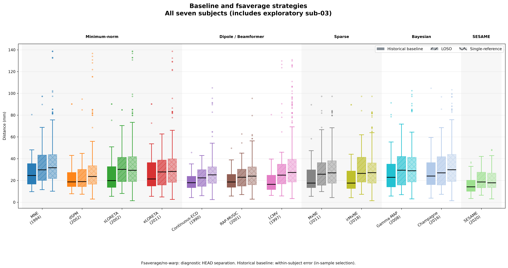

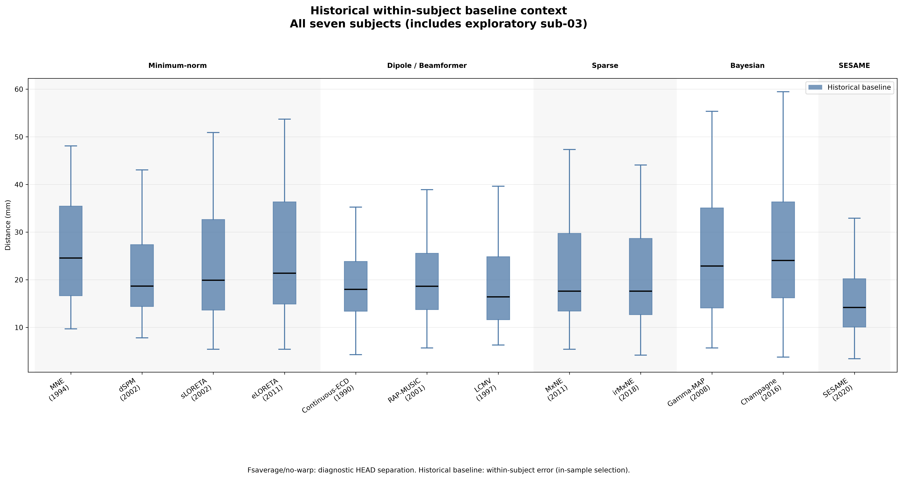

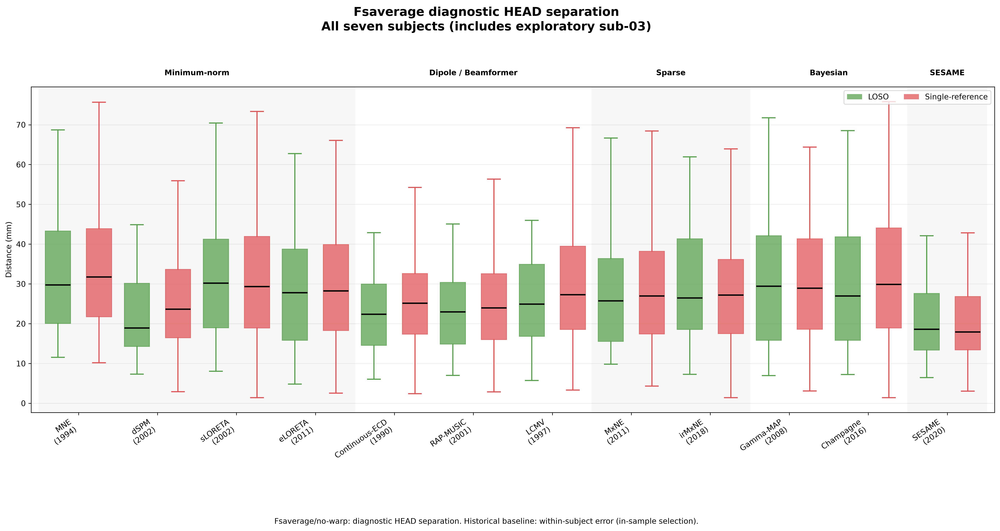

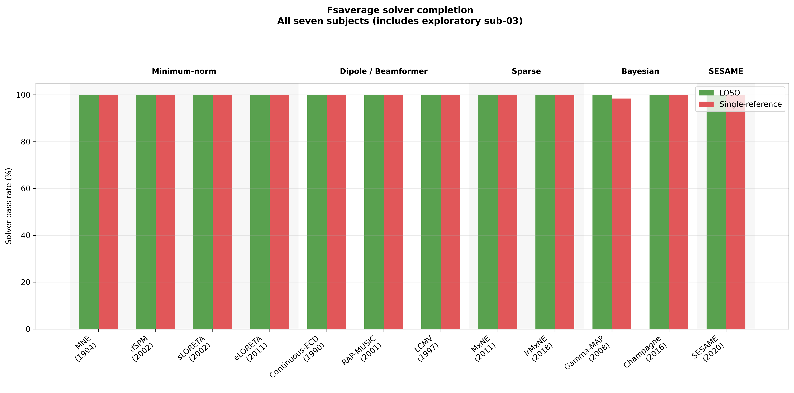

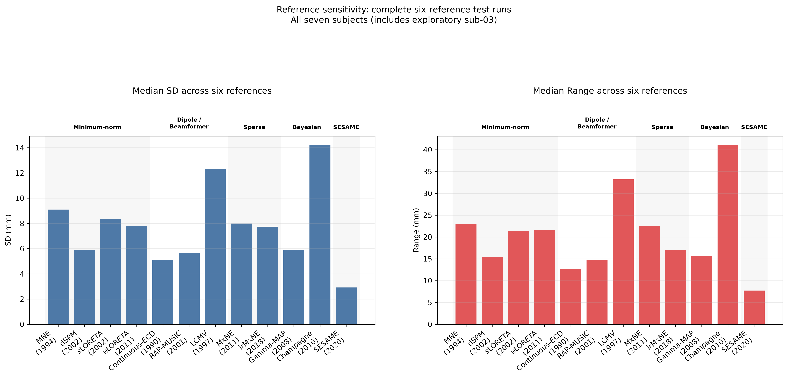

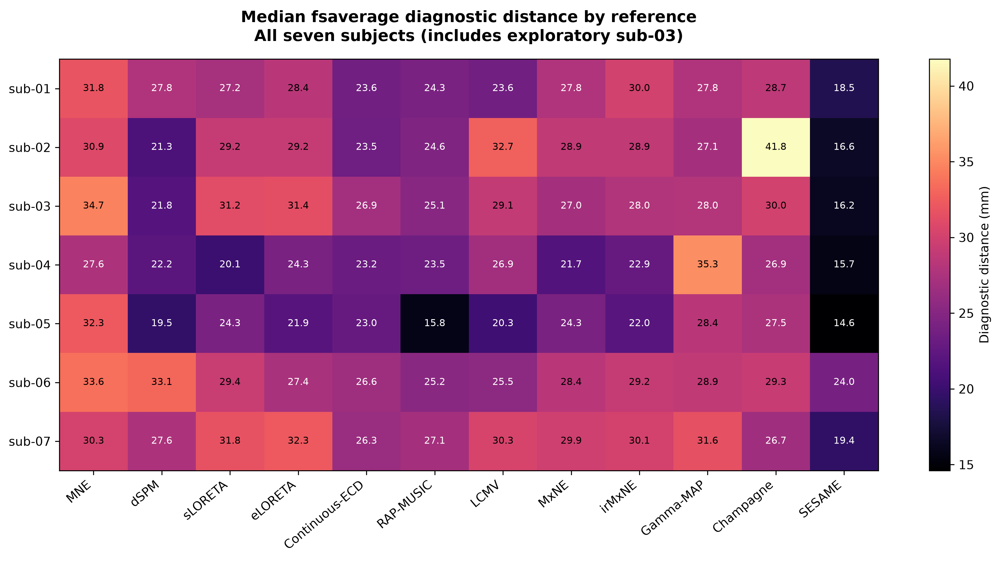

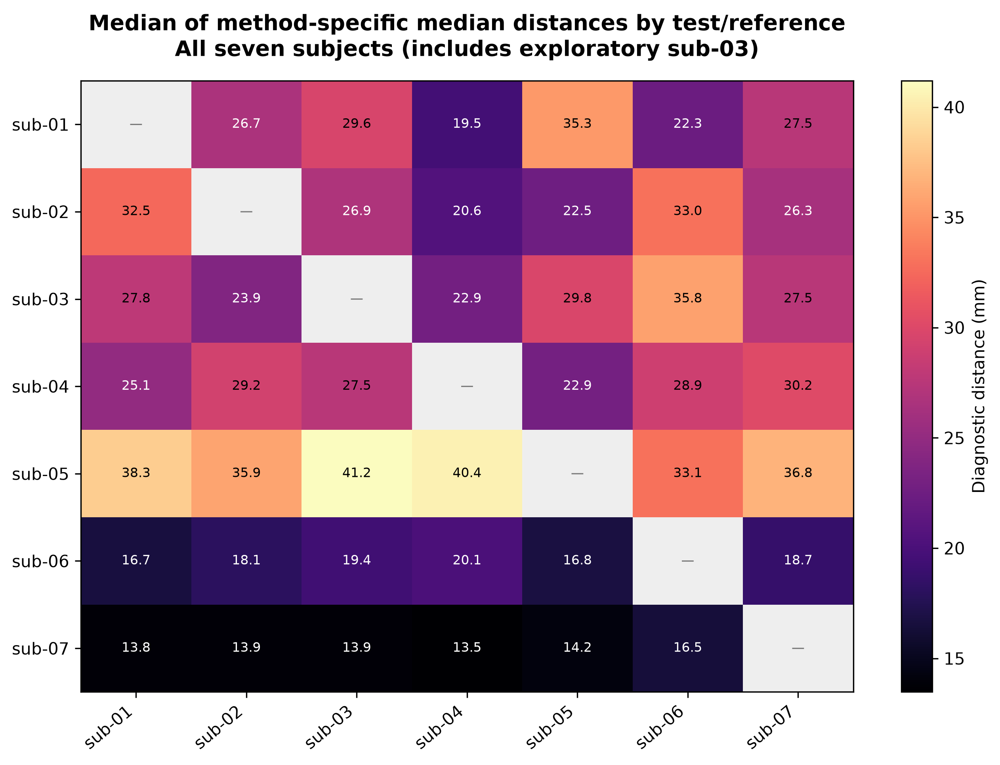

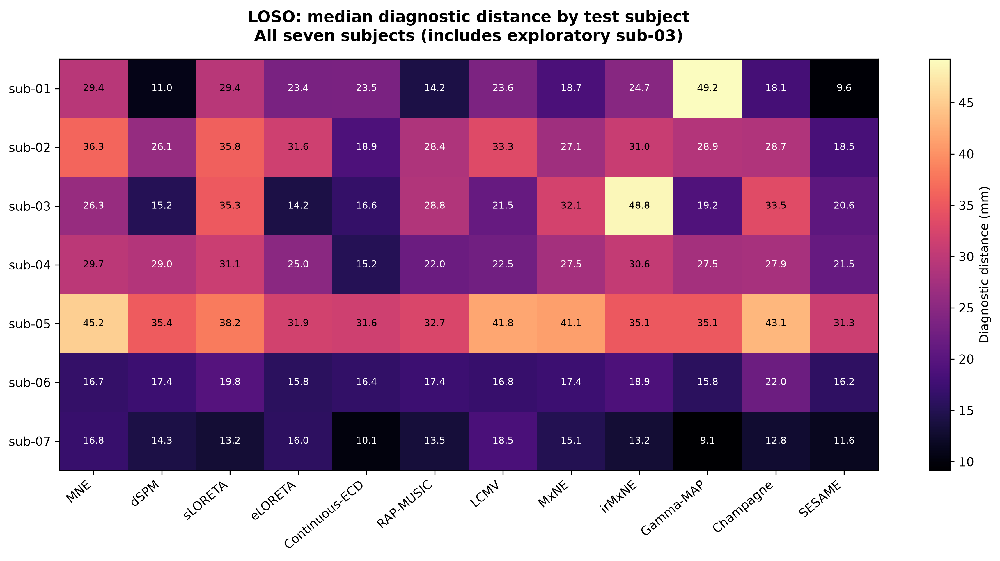

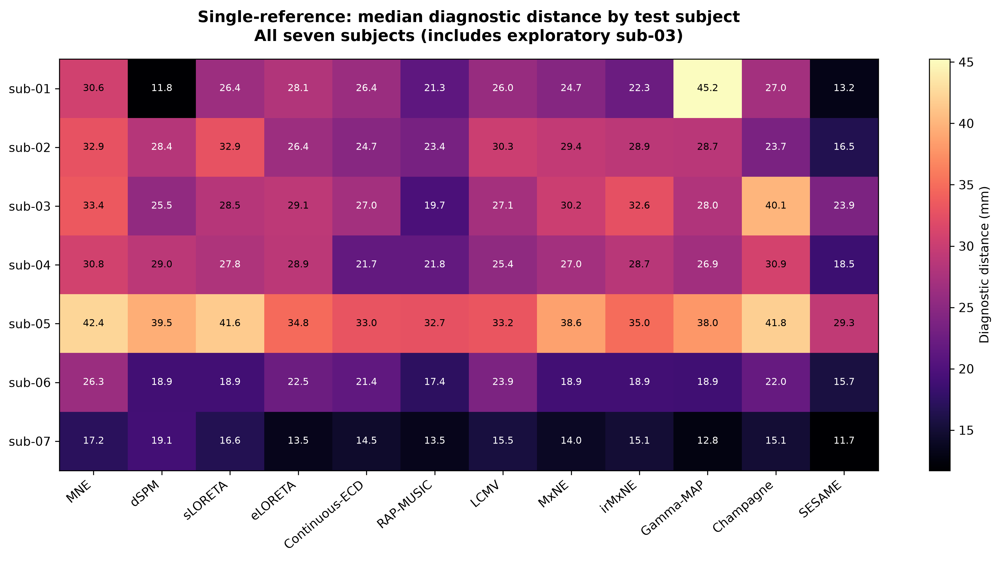

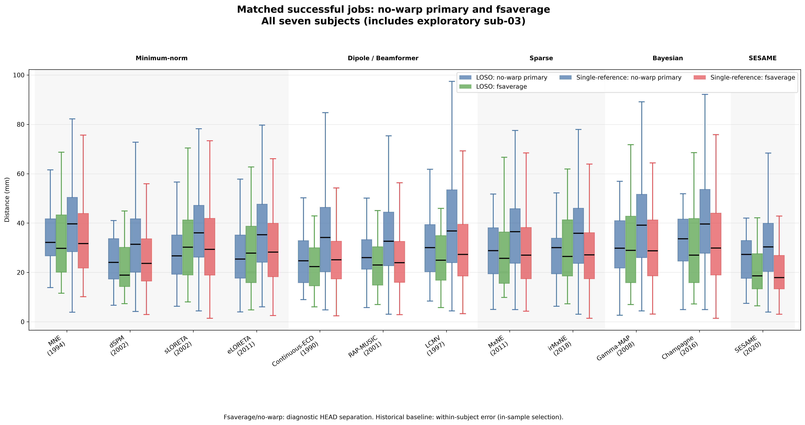

## Six subjects (anatomical review required)

6 test subject(s), 4536 jobs, 4530 PASS. Historical baseline: 648 distinct method/test-run values. Values below are pooled successful diagnostic distances; see equal-subject CSV for participant weighting.

| strategy | method | n_total | n_pass | median_mm | q25_mm | q75_mm |
| --- | --- | --- | --- | --- | --- | --- |
| LOSO | Champagne | 54 | 54 | 26.00 | 15.82 | 38.61 |
| LOSO | Continuous-ECD | 54 | 54 | 22.52 | 14.97 | 29.85 |
| LOSO | Gamma-MAP | 54 | 54 | 29.60 | 18.22 | 42.00 |
| LOSO | LCMV | 54 | 54 | 25.58 | 16.97 | 34.80 |
| LOSO | MNE | 54 | 54 | 33.52 | 24.54 | 44.41 |
| LOSO | MxNE | 54 | 54 | 25.66 | 15.60 | 36.07 |
| LOSO | RAP-MUSIC | 54 | 54 | 22.48 | 15.40 | 29.95 |
| LOSO | SESAME | 54 | 54 | 18.50 | 13.35 | 27.15 |
| LOSO | dSPM | 54 | 54 | 20.30 | 14.30 | 30.09 |
| LOSO | eLORETA | 54 | 54 | 28.12 | 15.97 | 38.57 |
| LOSO | irMxNE | 54 | 54 | 26.44 | 17.70 | 36.38 |
| LOSO | sLORETA | 54 | 54 | 29.99 | 19.14 | 41.24 |
| Single-reference | Champagne | 324 | 324 | 28.92 | 18.64 | 43.70 |
| Single-reference | Continuous-ECD | 324 | 324 | 25.11 | 17.96 | 32.21 |
| Single-reference | Gamma-MAP | 324 | 318 | 29.71 | 18.62 | 41.26 |
| Single-reference | LCMV | 324 | 324 | 27.30 | 19.10 | 38.09 |
| Single-reference | MNE | 324 | 324 | 31.10 | 21.34 | 44.07 |
| Single-reference | MxNE | 324 | 324 | 26.98 | 17.67 | 37.48 |
| Single-reference | RAP-MUSIC | 324 | 324 | 24.29 | 16.26 | 31.80 |
| Single-reference | SESAME | 324 | 324 | 16.90 | 13.35 | 26.46 |
| Single-reference | dSPM | 324 | 324 | 23.40 | 16.63 | 33.75 |
| Single-reference | eLORETA | 324 | 324 | 27.86 | 18.36 | 39.88 |
| Single-reference | irMxNE | 324 | 324 | 26.46 | 17.88 | 35.31 |
| Single-reference | sLORETA | 324 | 324 | 29.42 | 18.93 | 41.97 |

LOSO: smallest pooled median diagnostic distance is SESAME, 18.50 mm. This is descriptive and does not establish a validated anatomical accuracy ranking.

Single-reference: smallest pooled median diagnostic distance is SESAME, 16.90 mm. This is descriptive and does not establish a validated anatomical accuracy ranking.

Reference sensitivity uses sample SD (ddof=1) and range across six successful references per method/test/run. 4 method/test/run groups lack six successful references and are excluded from these variability summaries, while remaining in completion tables. Heatmaps display available medians; a blank diagonal means a subject is not its own single reference.

Matched no-warp comparison: 4521 jointly successful jobs of 4536 union keys. Negative paired deltas mean smaller fsaverage diagnostic separation. This comparison changes anatomy and test/reference sensor geometry; it does not isolate anatomy alone. Only no-warp primary peaks are used; no sensitivity variants are mixed in.

| strategy | method | n_subjects | mean_subject_median_delta_mm |
| --- | --- | --- | --- |
| LOSO | Champagne | 6 | -8.88 |
| LOSO | Continuous-ECD | 6 | -4.99 |
| LOSO | Gamma-MAP | 6 | -1.57 |
| LOSO | LCMV | 6 | -5.44 |
| LOSO | MNE | 6 | -3.23 |
| LOSO | MxNE | 6 | -5.22 |
| LOSO | RAP-MUSIC | 6 | -7.07 |
| LOSO | SESAME | 6 | -7.07 |
| LOSO | dSPM | 6 | -5.75 |
| LOSO | eLORETA | 6 | 0.93 |
| LOSO | irMxNE | 6 | -2.81 |
| LOSO | sLORETA | 6 | -2.46 |
| Single-reference | Champagne | 6 | -10.00 |
| Single-reference | Continuous-ECD | 6 | -12.21 |
| Single-reference | Gamma-MAP | 6 | -10.58 |
| Single-reference | LCMV | 6 | -7.93 |
| Single-reference | MNE | 6 | -6.40 |
| Single-reference | MxNE | 6 | -9.40 |
| Single-reference | RAP-MUSIC | 6 | -9.47 |
| Single-reference | SESAME | 6 | -12.27 |
| Single-reference | dSPM | 6 | -6.64 |
| Single-reference | eLORETA | 6 | -8.81 |
| Single-reference | irMxNE | 6 | -9.76 |
| Single-reference | sLORETA | 6 | -6.72 |

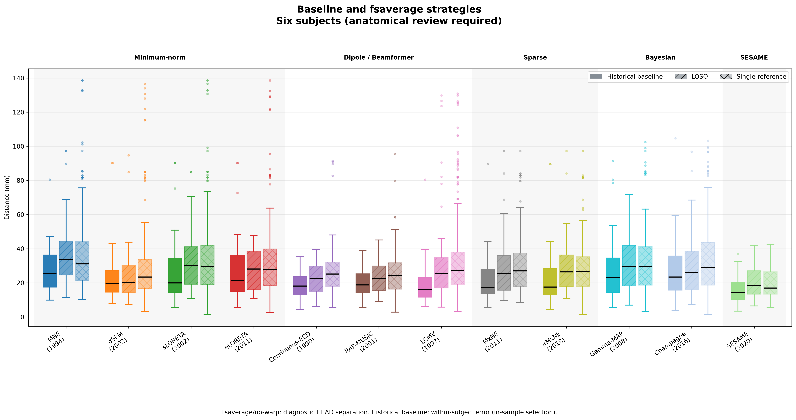

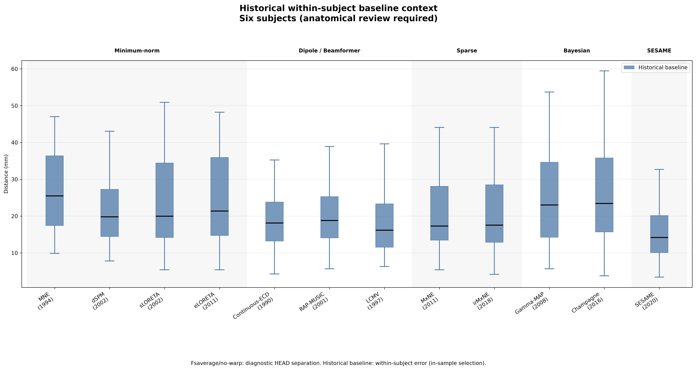

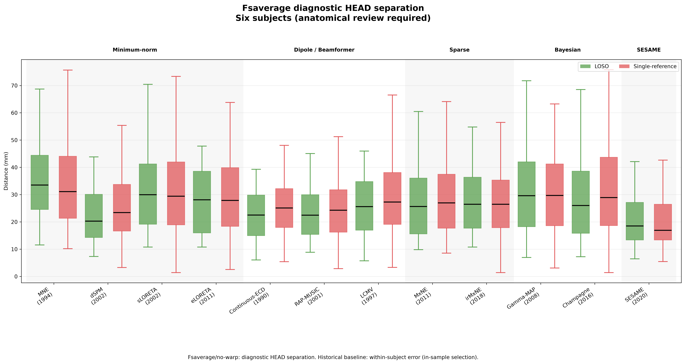

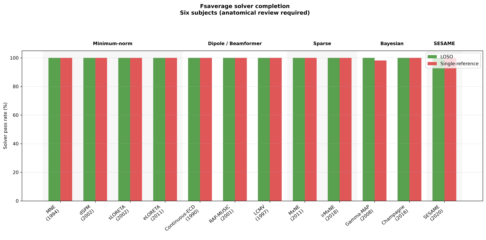

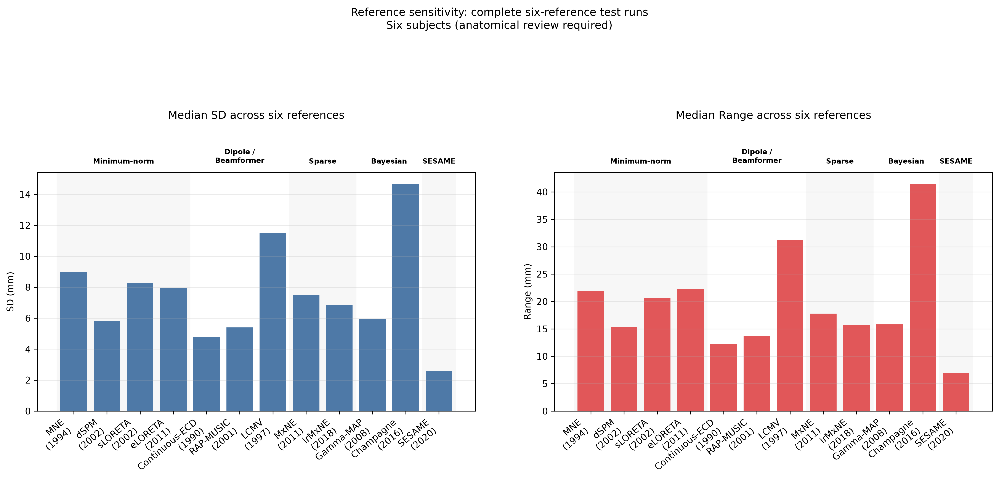

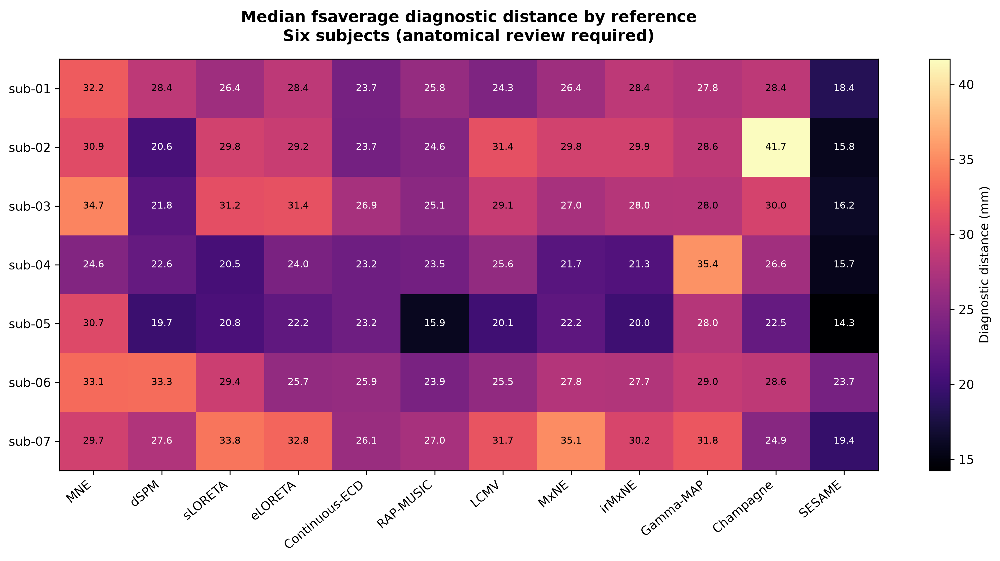

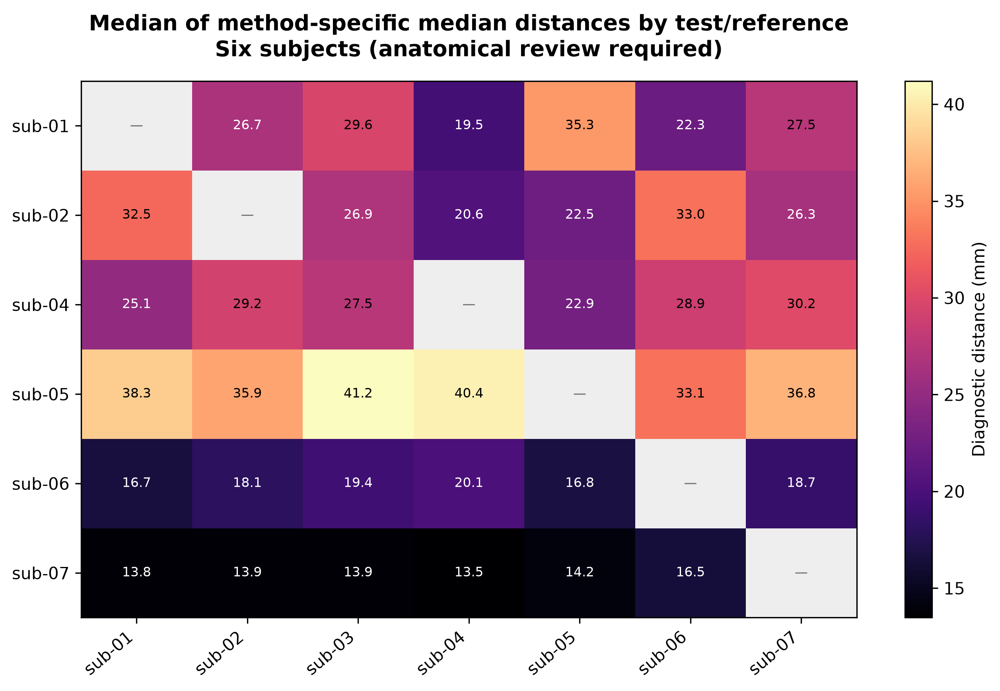

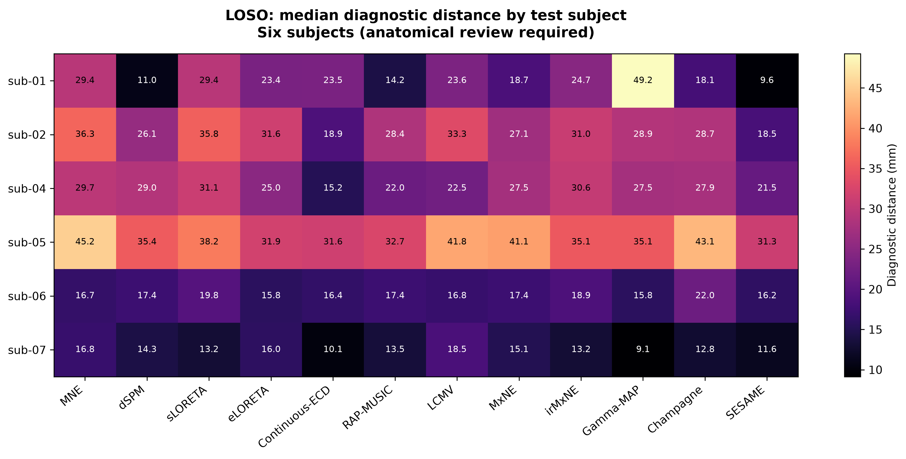

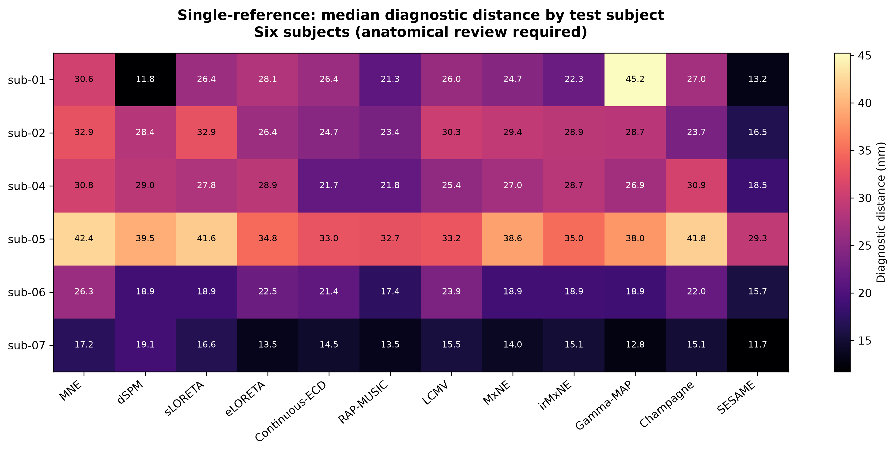

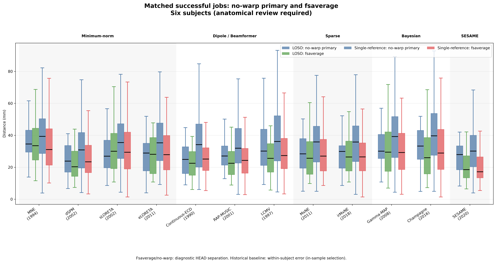

## Sub-03 only (failed alignment QA; exploratory)

1 test subject(s), 588 jobs, 588 PASS. Historical baseline: 84 distinct method/test-run values. Values below are pooled successful diagnostic distances; see equal-subject CSV for participant weighting.

| strategy | method | n_total | n_pass | median_mm | q25_mm | q75_mm |
| --- | --- | --- | --- | --- | --- | --- |
| LOSO | Champagne | 7 | 7 | 33.54 | 22.65 | 47.49 |
| LOSO | Continuous-ECD | 7 | 7 | 16.60 | 12.93 | 33.21 |
| LOSO | Gamma-MAP | 7 | 7 | 19.21 | 8.79 | 46.16 |
| LOSO | LCMV | 7 | 7 | 21.48 | 12.26 | 34.36 |
| LOSO | MNE | 7 | 7 | 26.32 | 19.81 | 32.66 |
| LOSO | MxNE | 7 | 7 | 32.13 | 15.81 | 50.45 |
| LOSO | RAP-MUSIC | 7 | 7 | 28.83 | 11.93 | 43.82 |
| LOSO | SESAME | 7 | 7 | 20.57 | 15.73 | 27.90 |
| LOSO | dSPM | 7 | 7 | 15.20 | 14.44 | 25.92 |
| LOSO | eLORETA | 7 | 7 | 14.22 | 11.54 | 41.88 |
| LOSO | irMxNE | 7 | 7 | 48.75 | 40.64 | 58.02 |
| LOSO | sLORETA | 7 | 7 | 35.29 | 21.28 | 41.30 |
| Single-reference | Champagne | 42 | 42 | 40.08 | 25.33 | 47.02 |
| Single-reference | Continuous-ECD | 42 | 42 | 26.99 | 12.50 | 46.29 |
| Single-reference | Gamma-MAP | 42 | 42 | 27.98 | 19.23 | 44.70 |
| Single-reference | LCMV | 42 | 42 | 27.11 | 14.67 | 54.98 |
| Single-reference | MNE | 42 | 42 | 33.42 | 28.14 | 42.58 |
| Single-reference | MxNE | 42 | 42 | 30.24 | 16.64 | 49.92 |
| Single-reference | RAP-MUSIC | 42 | 42 | 19.73 | 13.80 | 34.23 |
| Single-reference | SESAME | 42 | 42 | 23.88 | 14.81 | 34.98 |
| Single-reference | dSPM | 42 | 42 | 25.48 | 15.20 | 32.49 |
| Single-reference | eLORETA | 42 | 42 | 29.11 | 17.58 | 39.66 |
| Single-reference | irMxNE | 42 | 42 | 32.61 | 16.70 | 54.16 |
| Single-reference | sLORETA | 42 | 42 | 28.51 | 18.48 | 36.67 |

LOSO: smallest pooled median diagnostic distance is eLORETA, 14.22 mm. This is descriptive and does not establish a validated anatomical accuracy ranking.

Single-reference: smallest pooled median diagnostic distance is RAP-MUSIC, 19.73 mm. This is descriptive and does not establish a validated anatomical accuracy ranking.

Reference sensitivity uses sample SD (ddof=1) and range across six successful references per method/test/run. 0 method/test/run groups lack six successful references and are excluded from these variability summaries, while remaining in completion tables. Heatmaps display available medians; a blank diagonal means a subject is not its own single reference.

Matched no-warp comparison: 588 jointly successful jobs of 588 union keys. Negative paired deltas mean smaller fsaverage diagnostic separation. This comparison changes anatomy and test/reference sensor geometry; it does not isolate anatomy alone. Only no-warp primary peaks are used; no sensitivity variants are mixed in.

| strategy | method | n_subjects | mean_subject_median_delta_mm |
| --- | --- | --- | --- |
| LOSO | Champagne | 1 | 3.37 |
| LOSO | Continuous-ECD | 1 | 0.44 |
| LOSO | Gamma-MAP | 1 | 2.75 |
| LOSO | LCMV | 1 | -1.01 |
| LOSO | MNE | 1 | 0.81 |
| LOSO | MxNE | 1 | 6.64 |
| LOSO | RAP-MUSIC | 1 | 3.24 |
| LOSO | SESAME | 1 | 0.77 |
| LOSO | dSPM | 1 | -5.63 |
| LOSO | eLORETA | 1 | 3.24 |
| LOSO | irMxNE | 1 | 2.44 |
| LOSO | sLORETA | 1 | 14.25 |
| Single-reference | Champagne | 1 | -3.75 |
| Single-reference | Continuous-ECD | 1 | -8.87 |
| Single-reference | Gamma-MAP | 1 | -5.64 |
| Single-reference | LCMV | 1 | -4.99 |
| Single-reference | MNE | 1 | -2.61 |
| Single-reference | MxNE | 1 | -6.02 |
| Single-reference | RAP-MUSIC | 1 | -11.31 |
| Single-reference | SESAME | 1 | -3.29 |
| Single-reference | dSPM | 1 | -8.46 |
| Single-reference | eLORETA | 1 | -3.80 |
| Single-reference | irMxNE | 1 | 0.27 |
| Single-reference | sLORETA | 1 | -9.49 |

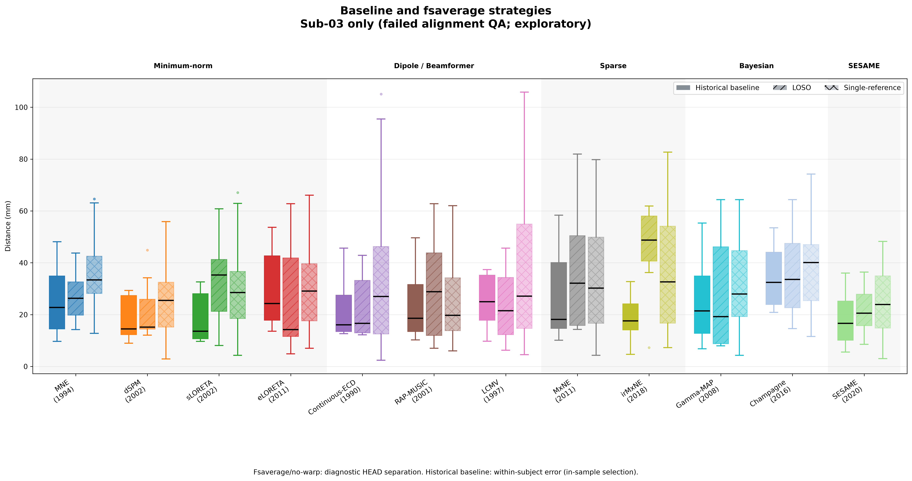

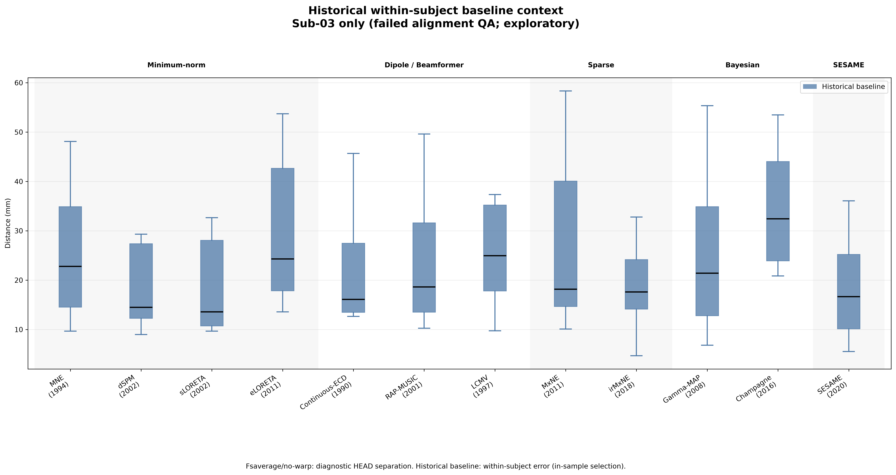

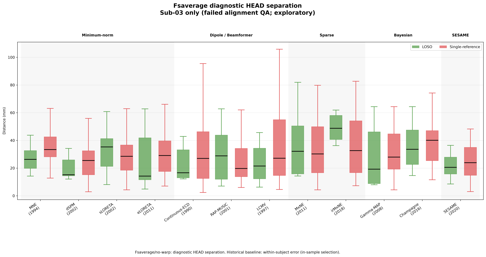

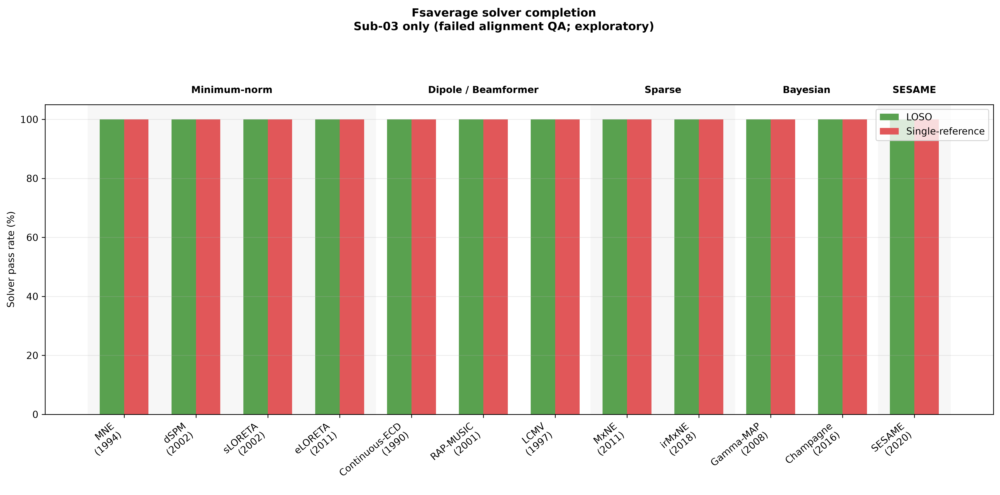

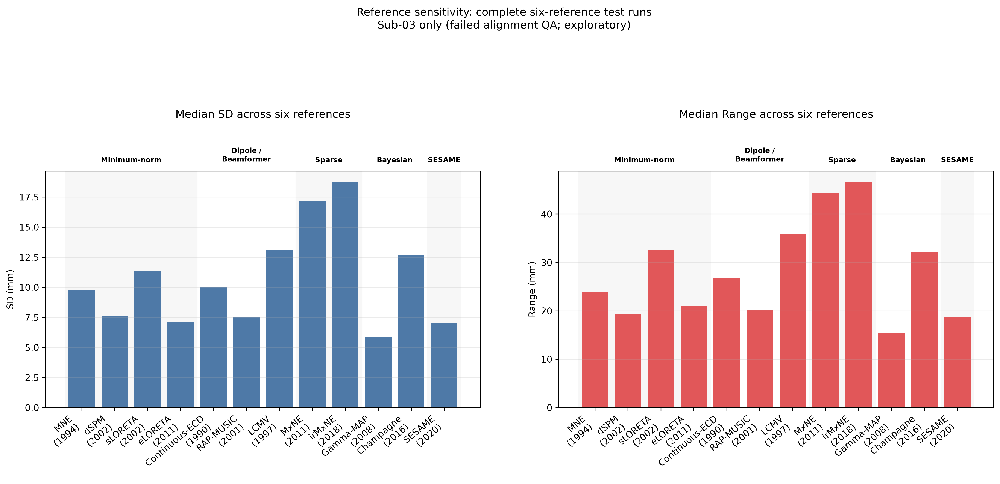

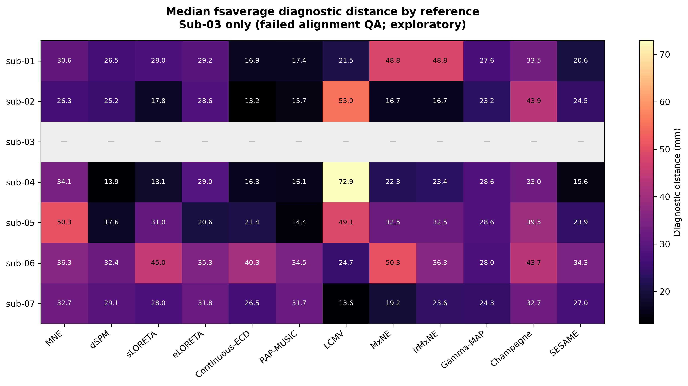

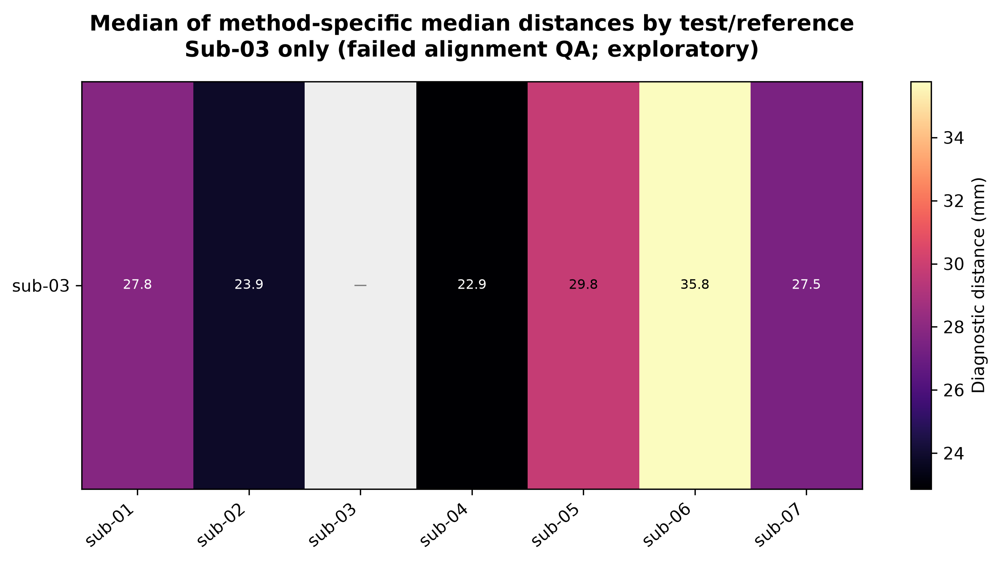

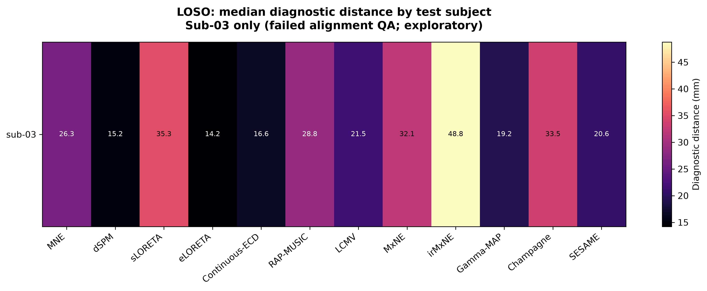

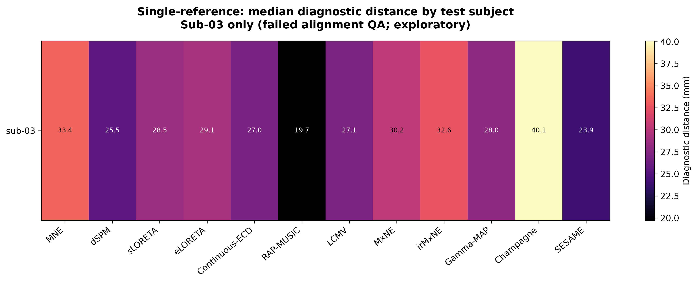

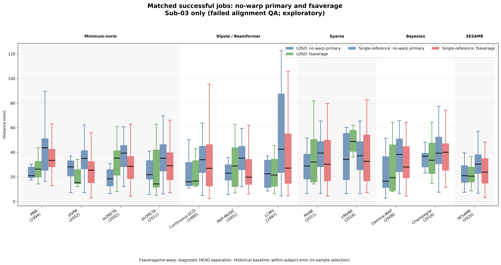

## Validation, reproducibility and next steps

The report verified the evaluation source hashes, exact 5,124 unique job keys, all 12 methods, PASS/FAIL distance availability and uniqueness of the 732 historical baseline rows. Reconstruction inputs were verified by the evaluation stage. Plot input tables and matching coverage are supplied in tables/. Files are generated in a fresh directory and reconstruction/evaluation inputs are not modified.

The no-warp plotting source supplies the original method order, year labels, family bands and box styles. PNG figures use 300 dpi. Master boxplots show outliers; comparison boxplots hide outlier markers using the same 1.5-IQR whiskers (values are retained in the tables). The all-seven view is an inclusive exploratory description, not a substitute for the separately reported QA cohorts.

Next: review sensor-to-template alignment and independent ground-truth mapping before interpreting anatomical localization accuracy. The existing MRI registration outputs have not been applied by this pipeline. Re-running solvers is not required to inspect these diagnostic results.
