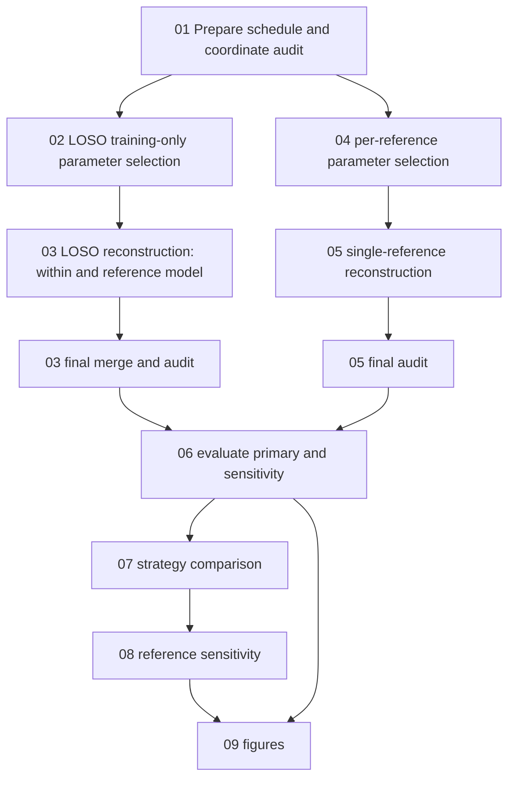

# Cross-subject no-warp experiment

## Index

- [Script documentation](01_scripts/01_prepare_experiment_schedule_and_coordinate_audit.md): [01](01_scripts/01_prepare_experiment_schedule_and_coordinate_audit.md), [02](01_scripts/02_select_loso_parameters.md), [03](01_scripts/03_reconstruct_reference_based_loso_conditions.md), [04](01_scripts/04_select_single_reference_parameters.md), [05](01_scripts/05_reconstruct_and_finalize_single_reference_experiment.md), [06](01_scripts/06_evaluate_localization_and_coordinate_diagnostics.md), [07](01_scripts/07_compare_strategies.md), [08](01_scripts/08_assess_reference_sensitivity.md), [09](01_scripts/09_visualize_results.md).
- [Output folders](02_outputs/01_01_prepare_experiment.md): [01](02_outputs/01_01_prepare_experiment.md), [02](02_outputs/02_02_select_loso_parameters.md), [03](02_outputs/03_03_reference_based_final.md), [04](02_outputs/04_04_single_reference_parameters.md), [05](02_outputs/05_05_single_reference_final.md), [06](02_outputs/06_06_evaluate_localization.md), [07](02_outputs/07_07_compare_strategies.md), [08](02_outputs/08_08_reference_sensitivity.md), [09](02_outputs/09_09_visualize_results.md).
- [Methodological decisions](03_methodological_decisions.md)
- [Failures and sensitivity](04_failures_and_sensitivity.md)
- [Dependencies and reproducibility](05_experiment_dependencies.md)

## Research design

Seven participants (sub-01–sub-07), 61 runs each, twelve methods. In LOSO, one participant is held out for testing and the other six train parameter selection. The primary reference is sub-01; sub-02 is used when sub-01 is the held-out test participant. Test subject and reference subject are distinct roles: the test subject contributes EEG and stimulation ground truth; the reference contributes a head model. The separately evaluated single-reference strategy chooses parameters per reference using the other six subjects, which can change both the model and configuration.

## Metric distinction

Within-subject anatomical localization error compares an estimated location to the test subject's stimulation location in the subject's own head coordinate frame. Cross-subject no-warp raw head-coordinate separation compares coordinates from different subjects without inter-brain registration. It is a diagnostic separation only, not a validated anatomical localization error.

## Workflow

No affine, SyN, or other inter-subject adjustment is used.
